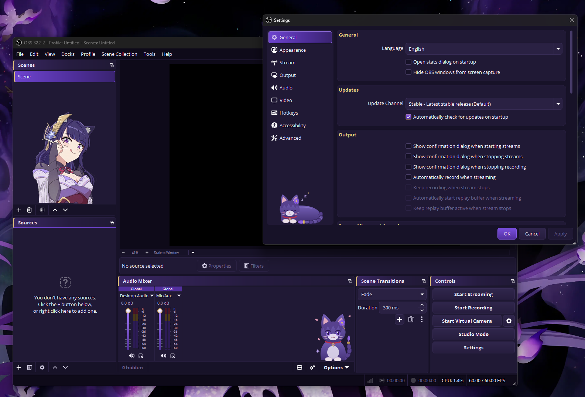

# Neko Raiden: an OBS Studio Theme

It's a **Yami style variant** for OBS 30 and newer, so any widget it doesn't restyle falls back to Yami's styling. It works on Windows, Linux (native and Flatpak) and macOS.



## Install

**Windows** (PowerShell):
```powershell
.\install.ps1
```

**Linux / macOS**:
```sh
sh install.sh
```

Restart OBS, then go to **Settings > Appearance** and pick **Theme: Yami**, **Style: Neko Raiden**.

To install somewhere else with `install.sh`, set `OBS_THEMES_DIR`.

## Artwork

This theme defines a few slots for artworks that you can override.

| Spot                   | Art                                     |
| ---------------------- | --------------------------------------- |
| Scenes dock            | `neko-raiden.png`: neko Raiden portrait |
| Sources dock           | none (free slot)                        |
| Audio mixer            | `sit.svg`: sitting neko                 |
| Settings category list | `loaf.svg`: napping neko                |

### Using your own pictures

The `set-art` scripts put an image (PNG, JPG, WebP, GIF or SVG) into a spot. They trim transparent margins, shrink the image to fit the spot (Qt can't scale stylesheet backgrounds), update `NekoRaiden.ovt`, and reinstall the theme.

Windows:
```powershell
.\set-art.ps1 -Slot sources -Image "C:\Pictures\raiden.png"
.\set-art.ps1 -Slot mixer -Image .\raiden.webp -Opacity 0.8
.\set-art.ps1 -Slot sources -Reset
```

Linux / macOS (needs ImageMagick, or Python 3 with Pillow):
```sh
sh set-art.sh sources ~/Pictures/raiden.png
sh set-art.sh mixer ./raiden.webp --opacity 0.8
sh set-art.sh sources --reset
```
